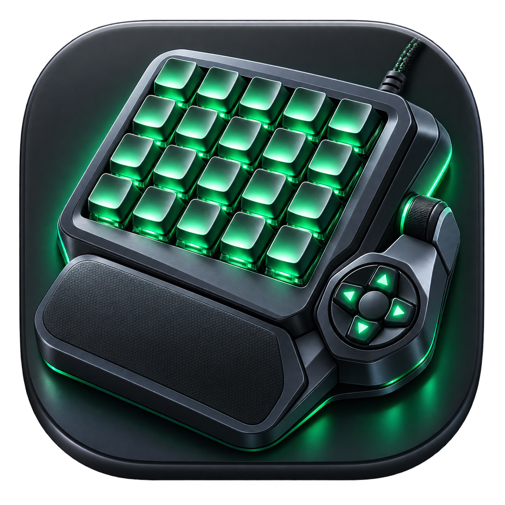

<p align="center">
  
</p>

# Orbweaver for macOS

Give your Razer Orbweaver or Tartarus V2 a useful life on a modern Mac. Orbweaver is a standalone native Rust app for configuring key mappings, shortcuts, profiles, and Chroma lighting through a graphical interface.

It runs locally, without Razer Synapse, a Razer account, Karabiner, or a third-party virtual keyboard driver. This independent project is not affiliated with or endorsed by Razer.

**Early development:** basic remapping has been exercised on both Orbweaver models. Tartarus V2 support is new: its USB identity and HID descriptors have been verified, but its key outputs and lighting are still awaiting a hands-on test. The app does not yet reproduce every Synapse feature, and compatibility with individual games needs testing.

## Features

- Configure 20 main keys, two thumb buttons, and eight thumb-pad directions on the Orbweaver, or 19 keys, the key-20 thumb paddle, the thumb button, and eight thumb-pad directions on the Tartarus V2.
- Assign keys, modifier shortcuts, timed key sequences, keymap switches, factory input, or disabled output.
- Use **Spam Key** to repeatedly press and release a key or shortcut while holding a control.
- Use eight keymaps per profile, with momentary or persistent switching.
- Create, rename, duplicate, import, export, and save profiles locally.
- Share the same key mappings between original and Chroma Orbweavers. Tartarus V2 profiles use their own layout.
- Control RGB brightness and choose solid color, per-key colors, spectrum, breathing, wave, or off on the Orbweaver Chroma and Tartarus V2.
- Learn a physical control and try its mapping in the app's local test field.

## Supported hardware and platform

| Device | USB ID | Key mappings | Lighting |
| --- | --- | --- | --- |
| Razer Orbweaver | `1532:0113` | Supported | Backlight control not implemented |
| Razer Orbweaver Chroma | `1532:0207` | Supported | RGB effects and brightness |
| Razer Tartarus V2 | `1532:022b` | Keys, thumb paddle, thumb button, and thumb pad; scroll wheel keeps its factory scrolling | RGB effects, per-key colors, and brightness through Razer's extended matrix protocol (hardware acknowledgment pending) |

Connect **one keypad at a time**. Other Razer keypads, including the Tartarus, Tartarus Chroma, and Tartarus Pro, are not currently supported. Tartarus V2 factory key assignments come from Razer's documentation and have not yet been recorded from a unit; use **Learn from device** for any control that differs. See the [Tartarus V2 research notes](docs/tartarus-v2-research.md).

Development and hardware testing have been performed on **Apple Silicon with macOS 26.6.1**. The bundle declares macOS 13 as its minimum, but older macOS versions and Intel Macs have not been verified. Windows and Linux are outside the current app's scope.

## Build and install

You need Git, Apple's Xcode Command Line Tools, and Rust with Cargo. The project has been built with Rust **1.97.1**. If the Apple tools are missing, run `xcode-select --install` and complete the installer before building.

```sh
git clone https://github.com/account50/Orbweaver-macOS.git
cd Orbweaver-macOS
./scripts/build-app.sh
```

The build produces `dist/Orbweaver.app`, including its Dock and Finder icon. Quit any running copy of Orbweaver, then install it:

```sh
ditto dist/Orbweaver.app /Applications/Orbweaver.app
open /Applications/Orbweaver.app
```

You can also open `dist/Orbweaver.app` directly. Use one installed copy consistently when granting macOS permissions. The build script does not create a Developer ID signed or notarized distribution.

By default the build is signed ad hoc, and macOS treats every rebuild as a new app, which silently invalidates the Accessibility and Input Monitoring grants. To keep those grants across rebuilds, create a local signing identity once:

```sh
./scripts/make-signing-identity.sh
```

This adds a self-signed "Orbweaver Local Signing" certificate to your login keychain, trusted for code signing only, and `build-app.sh` uses it automatically from then on. Grant the permissions one more time after the first signed build.

For updates, pull the latest source, rebuild, quit the running app, and repeat the installation commands. Your profiles are stored separately from the app bundle.

## First-time setup

1. Connect a supported keypad and open the app. Its model appears at the top of the window. Profiles belong to a layout: if the selected profile was made for the other keypad, the app offers to create one for the connected model.
2. Stop any other remapper or device utility from capturing this keypad.
3. Open **Device & test**, click **Open Accessibility settings**, and enable Orbweaver in **System Settings → Privacy & Security → Accessibility**. This lets the app send your mapped keys.
4. If macOS blocks device input, use **Set up Input Monitoring** on the same page and enable Orbweaver in Input Monitoring. Restart the app if macOS requests it.
5. Select a profile and click **Start remapping**. macOS may request administrator authentication for the temporary capture helper.
6. Confirm the status shows **ACTIVE**, then try a few keys in the **Device & test** text field.

The GUI runs as your normal user. A temporary helper needs administrator privileges to capture the keypad exclusively and suppress its original keystrokes. It captures only the supported keypad's keyboard interfaces; no permanent privileged service is installed.

## Configure your keypad

### Keys and keymaps

Choose a control in **Key mapping**, then select its assignment. For example, assign `command+c` for Copy, or use a sequence such as `command+c, command+v` with a delay between steps. Sequences run once per press; repeating a multi-step sequence is not implemented.

Each profile contains eight keymaps. A keymap-switch assignment can stay on the selected map or return when you release the switch. Thumb-pad diagonals use their two cardinal directions by default; an explicit diagonal assignment takes precedence.

If a control does not match the factory layout shown in the editor, start remapping, select **Learn from device**, and press and release that control. Learning suppresses its output. Click **Save & apply** to keep and activate your edits.

Key names describe US physical key positions. The active macOS keyboard layout determines the characters those positions produce.

### Spam Key: repeat taps while held

**Spam Key** sends a fresh key-down and key-up pair for each tap, instead of leaving the output key held down. It works with either supported Orbweaver model and is saved with your profile.

1. Select a control in **Key mapping**.
2. Choose **Spam Key** from the **Assignment** menu.
3. Enter **Key to spam**, such as `1`, `space`, `f5`, or `shift+tab`.
4. Set the interval and click **Save & apply**. Start remapping if it is paused.

Hold the physical control to repeat its assignment; release it to stop. The first tap starts immediately. The default interval is **100 ms**, or about 10 presses per second. You can choose **20–5000 ms**; lower values repeat faster. Timing is approximate and can slow under system load. Missed taps are skipped rather than replayed in a burst.

Stopping remapping, entering input-learning mode, or applying a profile cancels repetition. If another mapping holds an output used by the spam assignment, it waits until that output is available so it does not release another control's held key. Releasing and pressing the physical control starts a new repetition cycle.

### Profiles

Use the **New profile for** buttons, **Duplicate**, **Import**, and **Export** to manage profiles. Each new profile is created for the layout you pick, Orbweaver or Tartarus V2, regardless of which keypad is connected. Exported JSON files contain a single profile; Orbweaver profiles work with either Orbweaver model, and Tartarus V2 profiles carry a `family` field and their own 29 controls and 21 LED colors. Older files without that field load as Orbweaver profiles. The selected profile applies to every application while remapping is active; profiles do not switch automatically when another app gains focus.

Optional World of Warcraft example profiles are included for the [Orbweaver](profiles/world-of-warcraft.json) and the [Tartarus V2](profiles/world-of-warcraft-tartarus-v2.json). Import one through the GUI to try its mappings or use it as a starting point. They also apply globally while selected and do not detect whether WoW is running. The Tartarus version keeps keys 06–19 as on the Orbweaver, moves the Orbweaver's key-20 Space to the thumb button, and puts Shift on the key-20 thumb paddle.

The profile library is stored at:

```text
~/Library/Application Support/Orbweaver/profiles.json
```

Profiles live on the Mac, not in the keypad's onboard memory. Keep Orbweaver running for remapping to work. **Stop remapping** or a normal app quit restores factory input.

### Lighting and device swaps

On the Orbweaver Chroma and Tartarus V2, choose an effect and brightness in **Lighting**, then click **Save & apply**. Saving the profile and applying lighting are separate operations: check the status message for hardware errors. On the Tartarus V2 the per-key editor also includes the scroll-wheel LED. If the selected profile belongs to the other layout, the keypad receives the solid color instead of per-key colors.

The original Orbweaver does not receive RGB commands. Your profile's Chroma colors remain saved for the next Chroma connection.

To switch units, stop remapping, unplug the first keypad, connect the replacement, and wait for it to appear. Device discovery refreshes about every two seconds. Click **Start remapping** again; no profile conversion is needed between the two Orbweavers. Switching between an Orbweaver and a Tartarus V2 means selecting or creating a profile for that layout.

## Troubleshooting

| Symptom | What to check |
| --- | --- |
| Device unavailable | Connect exactly one supported keypad, check its USB connection, and use **Refresh device**. |
| HID access denied or “not permitted” | Check Orbweaver's Input Monitoring access and whether another utility has captured the keypad. |
| Remapping will not start or mapped keys are not sent | Check Accessibility access for the copy of Orbweaver you are running. |
| Permissions look enabled after an update, but access fails | Follow the permission refresh steps below; Settings may still refer to an older build. |
| Keys work in the test field but not in a game | The game may not accept CoreGraphics keyboard events. Game-specific compatibility is not guaranteed. |
| Mappings stop after reconnecting | Wait for device detection, then start remapping again. |

**Refreshing permissions after rebuilding:** ad-hoc signed builds have a new identity after every build even when their name stays the same (see the signing identity above to avoid this). Remove only Orbweaver's stale entry from the affected macOS privacy settings, quit and reopen the installed app, use its setup button to request access again, and enable the new entry. Leave other apps' entries unchanged.

## Current limitations

- No mouse, media-key, or joystick output; automatic application profiles; macro recording or looping multi-step sequences; or full Synapse profile import.
- No launch-at-login option or automatic capture restart after disconnecting.
- Original-model backlight control, reactive/ripple effects, and keymap indicator LEDs are not implemented.
- The Tartarus V2 scroll wheel is not captured or remappable; it keeps its factory mouse-wheel behavior. Its factory key assignments, firmware query, and LED placement still need confirmation on a unit.
- Chroma lighting commands have returned valid hardware acknowledgments, but exact visible colors and every LED's placement still need full validation.
- Complete control calibration, sleep/wake behavior, and target-game compatibility remain areas for hardware testing.
- Normal stop, profile changes, and connection failures release mapped outputs. A crash or force-quit cannot guarantee delivery of every synthesized key-release event.

The [restoration roadmap](docs/restoration-plan.md) describes the remaining work. Device observations and protocol references are in the [Orbweaver hardware research](docs/orbweaver-research.md) and the [Tartarus V2 research](docs/tartarus-v2-research.md).

## Development and diagnostics

```sh
cargo fmt --check
cargo test --locked
cargo clippy --locked --all-targets -- -D warnings
```

Automated tests cover profile validation, key and layer behavior, shared outputs, sequence cancellation, diagonals, recorded HID input, protocol checksums, and CLI errors. Spam Key tests cover distinct down/up pairs, release cancellation, interval limits, shortcut ordering, layer changes, shared outputs, delayed ticks, and profile serialization. The lighting hardware test is ignored by default because it changes the connected device's lighting.

The same executable also provides diagnostic commands:

```sh
./target/release/orbweaver --help
./target/release/orbweaver devices
./target/release/orbweaver inspect
./target/release/orbweaver permissions
./target/release/orbweaver probe --interface 2  # Chroma and Tartarus V2 firmware
```

To record a short physical-control test, stop GUI remapping first:

```sh
./target/release/orbweaver monitor --seconds 30 --output trial.jsonl --label key_01
```

Shared monitoring leaves factory keystrokes active. For an exclusive capture that suppresses those keystrokes, use `sudo ./target/release/orbweaver monitor --exclusive --seconds 30`. Recordings contain raw keypad input and refuse to overwrite an existing output file; record only deliberate test presses when preparing a trace to share.

The app uses eframe/egui for its native interface, HIDAPI/IOKit for device access, CoreGraphics for mapped keyboard output, and a private local socket between the GUI and capture helper. Runtime configuration requires no account or network service. To regenerate the bundled icon sizes after editing the PNG artwork, run `./scripts/build-icon.sh`.

Bug reports and hardware test results are welcome in [GitHub Issues](https://github.com/account50/Orbweaver-macOS/issues). Include your keypad model, macOS version, Mac architecture, steps to reproduce, and the exact error shown by the app.
